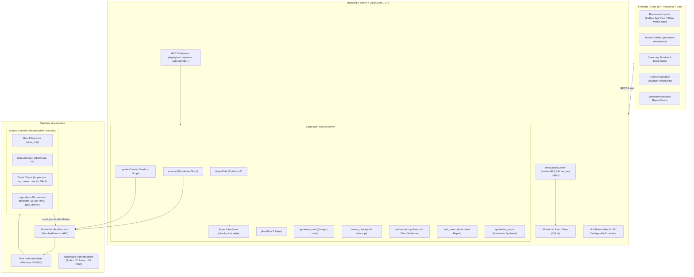

# AutoAnalyst: Autonomous Data-Science Agent with Sandboxed Code Execution

[](https://www.python.org/)
[](https://fastapi.tiangolo.com/)
[](https://langchain-ai.github.io/langgraph/)
[](https://www.docker.com/)
[](https://react.dev/)
[](https://www.typescriptlang.org/)

**AutoAnalyst** is an autonomous, production-grade data-science agent. A user uploads a CSV or Parquet dataset and poses an analytical question in plain English. The agent formulates a structured analytical plan, executes trusted data profiling, iteratively writes self-contained Python scripts, executes them inside isolated Docker containers, self-corrects on syntax or runtime errors, supports real-time human code inspection and editing before execution, and synthesizes an executive Markdown report complete with dynamic interactive charts.

---

## Architecture Overview



---

## How the Safety Guarantees Work

AutoAnalyst is built under strict defensive security, container sandboxing, and loop-prevention constraints. Untrusted code generated by language models is never executed directly on the host.

### 1. Multi-Layer Container Isolation
Every script executes in a **fresh, single-use container** that is immediately destroyed in a `finally` block:
- **Network Egress Blocked**: `network_disabled=True` completely disables socket access. User code cannot exfiltrate data, query external APIs, or download packages.
- **Read-Only Root Filesystem**: `read_only=True` renders `/`, `/etc`, `/usr`, `/var`, and all system directories immutable.
- **Dataset Read-Only Mount**: Datasets are mounted strictly read-only (`:ro`) at `/data/input.<ext>`. The original dataset cannot be modified, corrupted, or deleted.
- **Restricted Tmpfs Output**: Code can only write output files into `/tmp/output`, mounted via tmpfs with flags `rw,noexec,nosuid,size=50m`. Scripts cannot execute binaries from temporary directories.
- **Non-Root Execution**: Runs under fixed non-root user `sandboxuser` (`UID 1000:1000`). Root escalation is blocked via `security_opt=["no-new-privileges:true"]`.
- **Dropped Linux Capabilities**: All kernel capabilities are stripped: `cap_drop=["ALL"]`.
- **Hard Resource Quotas**:
  - Memory: `mem_limit="512m"` and `memswap_limit="512m"` (prevents host memory or swap exhaustion).
  - CPU: `cpu_quota=100000` (capped at 1 CPU equivalent).
  - Process/Thread Ceiling: `pids_limit=50` completely halts fork bombs without degrading the host system.
- **Streaming Log Cap**: Standard output and error streams are capped at 10KB. If code attempts log flooding, output is truncated and the container is killed immediately.
- **OOM Detection & Daemon Resilience**: Containers killed by out-of-memory are inspected via `State.OOMKilled` and converted into structured `ExecutionResult(status="oom")`. If the Docker daemon is unavailable, the executor returns a structured `daemon_unavailable` failure without crashing the graph.
- **Pre-Execution Archive Extraction**: `/tmp/output/result.json` is retrieved using `container.get_archive()` before container destruction and validated against the Pydantic `ChartSpec` schema (enforcing `line`, `bar`, `scatter`, `bar_grouped`, and $\le$ 500 data points).
- **Environment & Temp Configuration**: `HOME=/tmp/output`, `MPLCONFIGDIR=/tmp/output/.matplotlib`, and `DUCKDB_TEMP_DIRECTORY=/tmp/output/.duckdb_temp` ensure libraries never fail due to the read-only rootfs.

### 2. Cross-Platform Mount Normalization
Host filesystem paths on Windows (e.g. `C:\Users\username\data.csv`) and Linux/macOS POSIX paths are sanitized using `backend/sandbox/path_normalizer.py`. Drive letters are converted to POSIX format (`/c/Users/...`), path traversal sequences are resolved, and only dedicated per-run directories are mounted.

### 3. Cumulative Execution Model
Each analytical step generates a self-contained cumulative script containing verified code from prior successful steps followed by the new step's logic. If cumulative script length exceeds 64KB, execution is rejected before container startup.

### 4. Loop & Crash Protection
- **Per-Step Retry Cap**: Up to 3 self-correction attempts per analytical plan step (`MAX_RETRIES_PER_STEP = 3`).
- **Repeated-Failure Guard**: Extracts and normalizes the exception type and message into a canonical `error_signature`. If the same error signature or code hash repeats on consecutive retries, execution is halted immediately to prevent wasteful loops.
- **Total Graph Recursion Cap**: `MAX_TOTAL_ITERATIONS = 25`. Dynamic recursion limits prevent recursion exhaustion (`recursion_limit = max_steps * (1 + max_retries) * nodes_per_attempt + overhead`).
- **Non-Critical Step Resiliency**: Failed non-critical steps do not abort the entire run; the agent records the partial failure and continues with subsequent steps.
- **Active Wall-Clock Tracking**: Only active container computation counts towards the active limit (default 300s). Time spent waiting in pause mode is excluded. Pause sessions exceeding 30 minutes (`MAX_PAUSE_TTL_SECONDS = 1800`) are automatically aborted.
- **Terminal Guarantees**: Every graph path strictly terminates at `completed`, `failed`, `budget_exceeded`, or `aborted`, emitting an analytical Markdown summary report (or partial report on failures).

### 5. Server Restart Resilience & Idempotent HITL
- State checkpointing uses LangGraph's asynchronous `AsyncSqliteSaver` writing snapshots to `backend/data/checkpoints.sqlite`.
- The `human_checkpoint` node is **strictly idempotent** with zero side effects before `interrupt()`.
- Resuming is performed via `graph.ainvoke(Command(resume={"edited_code": code}))`. If the backend server crashes or reboots while a run is paused, the state thread is restored from disk and resumes execution seamlessly.

---

## Directory Structure

```text
autoanalyst/
├── backend/
│   ├── app/
│   │   ├── api/
│   │   │   ├── routes_runs.py          # REST endpoints (start, get, pause, resume, abort)
│   │   │   ├── routes_upload.py        # Secure CSV/Parquet upload & sample loader
│   │   │   └── websocket.py            # WebSocket stream with last_seq event replay
│   │   ├── core/
│   │   │   ├── config.py               # System limits, timeouts, and paths
│   │   │   ├── event_store.py          # SQLite persistence for monotonic events
│   │   │   ├── events.py               # Typed AgentEvent models and factory
│   │   │   ├── models.py               # Pydantic request/response schemas
│   │   │   └── run_manager.py          # Run orchestration and WebSocket broadcasting
│   │   └── main.py                     # FastAPI application factory & CORS configuration
│   ├── graph/
│   │   ├── builder.py                  # LangGraph 0.2+ StateGraph compilation
│   │   ├── edges.py                    # Routing conditions, loop counters & failure gates
│   │   ├── llm.py                      # LLM provider router & deterministic MockLLM
│   │   ├── profiler.py                 # Trusted, deterministic data profiling script
│   │   ├── state.py                    # AgentState and PlanStep Pydantic v2 schemas
│   │   └── nodes/                      # Graph execution nodes (plan, profile, code, etc.)
│   ├── sandbox/
│   │   ├── base.py                     # SandboxExecutor ABC interface
│   │   ├── docker_executor.py          # Docker container isolation & lifecycle manager
│   │   ├── mock_executor.py            # Offline mock sandbox executor for testing
│   │   ├── path_normalizer.py          # Cross-platform Windows/POSIX path normalizer
│   │   └── result.py                   # ExecutionResult and ChartSpec schema validation
│   ├── tests/                          # Adversarial security, graph, and API test suite
│   ├── pytest.ini                      # Pytest configuration with @pytest.mark.docker
│   └── requirements.txt                # Locked backend dependencies
├── frontend/
│   ├── src/
│   │   ├── components/                 # Header, Uploader, Timeline, Monaco Editor, Recharts, Report
│   │   ├── hooks/                      # useWebSocket (with replay) & useRunState
│   │   ├── types/                      # TypeScript interfaces matching backend models
│   │   ├── App.tsx                     # Responsive split-view and mobile tab layout
│   │   ├── App.css                     # Custom dark theme styles
│   │   └── main.tsx
│   ├── package.json
│   ├── tsconfig.json
│   └── vite.config.ts
├── sandbox-image/
│   └── Dockerfile                      # Non-root Python 3.12-slim sandbox image
├── sample-data/
│   ├── generate_sample_data.py         # Synthetic dataset generator
│   └── ecommerce_sales.csv             # Generated 500-row sample dataset
├── README.md                           # System architecture and documentation
├── .env.example                        # Template for environment configuration
└── .gitignore
```

---

## Environment Configuration

Configure AutoAnalyst runtime settings via environment variables (or `.env` file):

| Variable | Default | Description |
| :--- | :--- | :--- |
| `LLM_PROVIDER` | `mock` | LLM backend: `mock`, `openai`, `anthropic`, or `gemini` |
| `LLM_MODEL` | `mock-analyst-v1` | Target model identifier |
| `LLM_API_KEY` | `""` | API key for the configured LLM provider |
| `LLM_CALL_BUDGET` | `30` | Maximum allowed LLM calls per run |
| `LLM_TOKEN_BUDGET` | `100000` | Maximum token ceiling per run |
| `SANDBOX_PROVIDER` | `auto` | Execution mode: `auto` (uses Docker if active, otherwise mock), `docker`, or `mock` |
| `SANDBOX_IMAGE` | `autoanalyst-sandbox:latest` | Docker image name for sandbox containers |
| `SANDBOX_TIMEOUT_SECONDS` | `30` | Per-execution hard container timeout |
| `MAX_RETRIES_PER_STEP` | `3` | Maximum self-correction retries per plan step |
| `MAX_TOTAL_ITERATIONS` | `25` | Maximum total LangGraph iterations per run |
| `MAX_PAUSE_TTL_SECONDS` | `1800` | Pause timeout (30 min) before automatic abort |
| `ACTIVE_WALL_CLOCK_LIMIT_SECONDS` | `300` | Active computation timeout (excludes paused time) |

---

## Sandbox Image Build

Build the non-root sandbox image:

```powershell
docker build -t autoanalyst-sandbox:latest sandbox-image/
```

Verify image properties:
```powershell
# Verify non-root user UID 1000
docker run --rm autoanalyst-sandbox:latest id
# uid=1000(sandboxuser) gid=1000(sandboxuser)

# Verify allowed data-science libraries
docker run --rm autoanalyst-sandbox:latest python -c "import pandas, polars, duckdb, pyarrow, matplotlib; print('Ready')"
```

---

## Quickstart & Local Development

### 1. Prerequisites
- **Python**: 3.11 or 3.12
- **Node.js**: v18+ (tested on Node v20/v22/v24)
- **Docker**: Docker Desktop (optional for test suite; `@pytest.mark.docker` skips cleanly when offline)

### 2. Backend Setup
```powershell
# Navigate to monorepo root
cd autoanalyst

# Create and activate virtual environment
python -m venv .venv
.\.venv\Scripts\Activate.ps1

# Install locked dependencies
pip install -r backend/requirements.txt

# Run the complete test suite
pytest -v -c backend/pytest.ini backend/tests/test_path_normalizer.py backend/tests/test_sandbox.py backend/tests/test_graph.py backend/tests/test_api.py

# Launch FastAPI server
python -m uvicorn backend.app.main:app --host 127.0.0.1 --port 8008
```

### 3. Frontend Setup
```powershell
# In a new terminal, navigate to frontend directory
cd autoanalyst/frontend

# Install dependencies
npm install

# Build production bundle
npm run build

# Start Vite dev server
npm run dev
```

Open your browser to `http://localhost:5175`.

---

## Realtime WebSocket Protocol

Each run exposes a real-time event stream at `/ws/runs/{run_id}`:
- **Monotonic Sequence Replay**: Reconnecting clients pass `?last_seq={N}`. The server immediately replays all events where `seq > N` in ascending order before switching to live broadcast.
- **Heartbeat**: Clients send `{"type": "ping"}` and the server responds with `{"type": "pong"}`.
- **Event Catalog**:
  - `state_transition`: Graph status transitions (`pending` $\to$ `planning` $\to$ `running` $\to$ `completed`).
  - `plan`: Structured plan steps.
  - `thought`: Visible agent rationale.
  - `code`: Generated or corrected Python code.
  - `execution_started`: Container execution start notification.
  - `stdout` / `stderr`: Streamed execution logs.
  - `execution_result`: Execution duration, exit code, and error signatures.
  - `chart`: Validated `result.json` visualization payload.
  - `retry`: Self-correction retry notifications.
  - `paused`: Interruption for human review.
  - `resumed`: Confirmation of execution resumption.
  - `report`: Synthesized Markdown analytical report.
  - `run_status`: Terminal run status.

---

## REST API Reference

| Method | Endpoint | Description |
| :--- | :--- | :--- |
| `POST` | `/api/upload` | Upload CSV/Parquet file (enforces 50MB limit & extension check) |
| `POST` | `/api/upload/sample` | Load pre-packaged synthetic e-commerce sales dataset |
| `POST` | `/api/runs` | Start a new analysis run (`user_question`, `dataset_path`, `review_before_run`) |
| `GET` | `/api/runs/{id}` | Fetch current state, plan, and persisted event history |
| `POST` | `/api/runs/{id}/pause` | Signal active run to pause before next execution step |
| `POST` | `/api/runs/{id}/resume` | Resume execution with optional user-edited code |
| `POST` | `/api/runs/{id}/abort` | Terminate running containers and mark run aborted |
| `GET` | `/api/health` | Service health status check |

---

## Chart Specification Contract

Scripts generating visual analytics write to `/tmp/output/result.json` matching the `ChartSpec` schema:

```json
{
  "chart_type": "bar",
  "title": "Total Revenue by Product Category",
  "x_label": "Category",
  "y_label": "Total Sales ($)",
  "series": ["sales"],
  "data": [
    {"category": "Electronics", "sales": 45200.0},
    {"category": "Home & Kitchen", "sales": 32150.0},
    {"category": "Apparel", "sales": 28400.0},
    {"category": "Sports & Outdoors", "sales": 19800.0},
    {"category": "Books & Stationery", "sales": 11250.0}
  ]
}
```

Constraints:
- Supported types: `line`, `bar`, `scatter`, `bar_grouped`.
- Maximum data points: **500 points**.
- If invalid or unparseable, treated as a step error that triggers automatic self-correction.

---

## Automated Test Suite

Run all unit, adversarial sandbox, state machine, and API integration tests:

```powershell
pytest -v -c backend/pytest.ini
```

Verified test coverage:
- ✅ **Host Path Normalization** (`test_path_normalizer.py`): Windows drive letters (`C:\...`), mixed slashes, redundant quotes, POSIX absolute paths, dataset extension mapping.
- ✅ **Sandbox Security** (`test_sandbox.py`): Container limits inspection, infinite loop timeout kill, socket egress blocking, read-only root rejection, OOM kill handling, fork bomb PID limits.
- ✅ **Self-Correction** (`test_graph.py`): Runtime `KeyError` triggers `self_correct` node and succeeds on retry.
- ✅ **Retry Cap Enforcement** (`test_graph.py`): Persistent failures stop at 3 retries and emit a partial report.
- ✅ **Repeated-Failure Detection** (`test_graph.py`): Repeating identical error signatures halts loops early.
- ✅ **Process Restart Persistence** (`test_graph.py`): Runs paused with `interrupt()` resume cleanly from `checkpoints.sqlite` across separate process lifespans using `Command(resume=...)`.
- ✅ **REST & WebSocket API** (`test_api.py`): Valid and invalid file upload handling, full run lifecycle, and monotonic WebSocket sequence replay.

---

## Walkthrough Reports
- Phase 1 Walkthrough: [walkthrough_phase1.md](file:///C:/Users/itzst/.gemini/antigravity/brain/4401ee83-2446-4761-8790-24a73a60bd79/walkthrough_phase1.md)
- Phase 2 Walkthrough: [walkthrough_phase2.md](file:///C:/Users/itzst/.gemini/antigravity/brain/4401ee83-2446-4761-8790-24a73a60bd79/walkthrough_phase2.md)
- Phase 3 Walkthrough: [walkthrough_phase3.md](file:///C:/Users/itzst/.gemini/antigravity/brain/4401ee83-2446-4761-8790-24a73a60bd79/walkthrough_phase3.md)
- Phase 4 Walkthrough: [walkthrough_phase4.md](file:///C:/Users/itzst/.gemini/antigravity/brain/4401ee83-2446-4761-8790-24a73a60bd79/walkthrough_phase4.md)
- Phase 5 Walkthrough (with UI Screenshots): [walkthrough_phase5.md](file:///C:/Users/itzst/.gemini/antigravity/brain/4401ee83-2446-4761-8790-24a73a60bd79/walkthrough_phase5.md)
